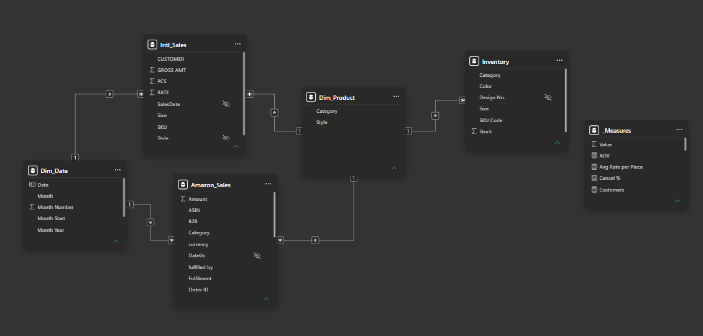
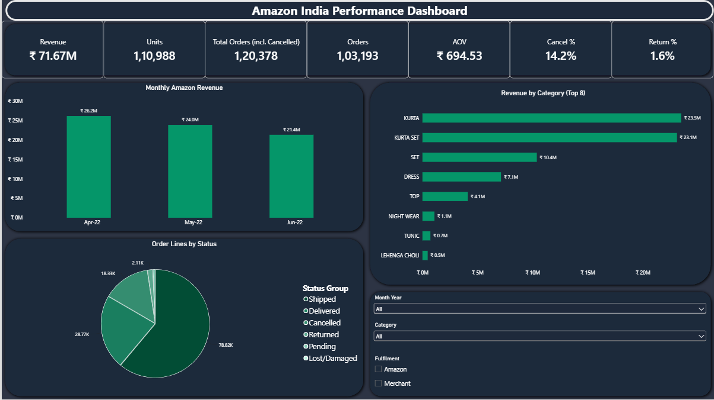
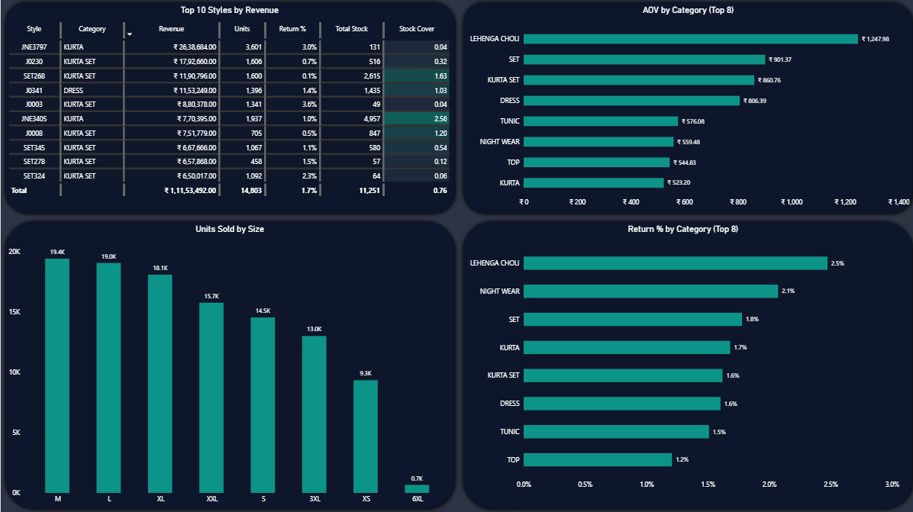
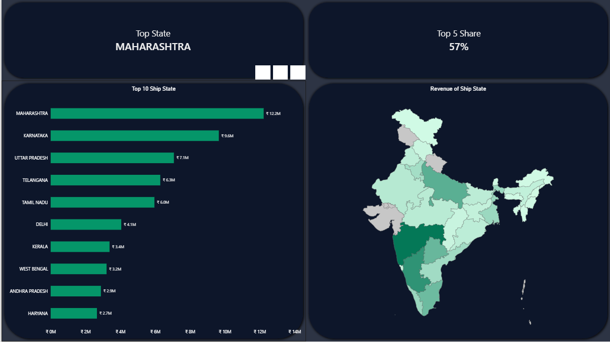
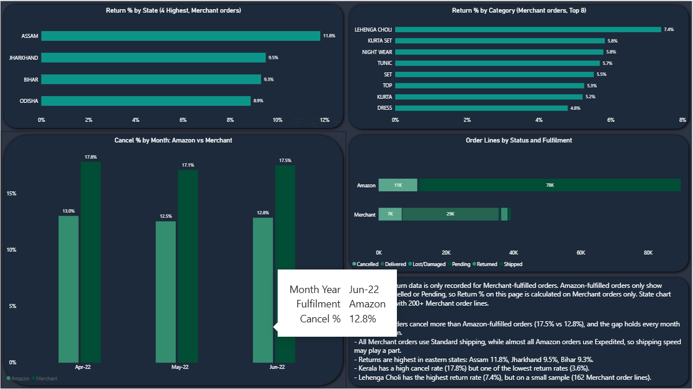
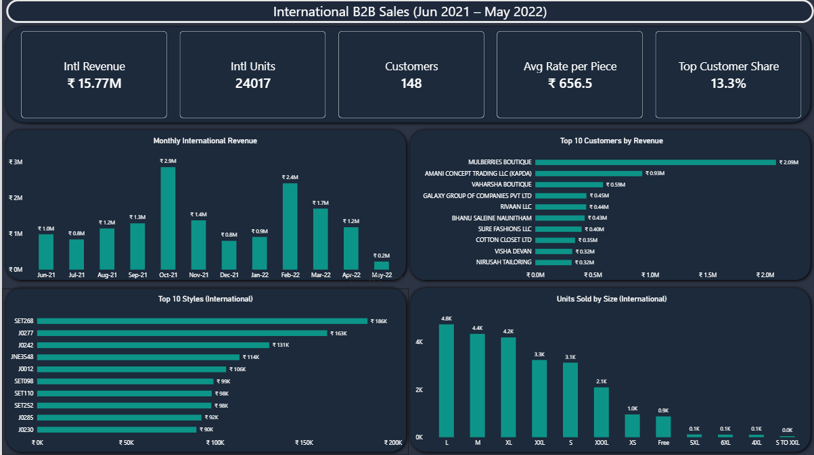
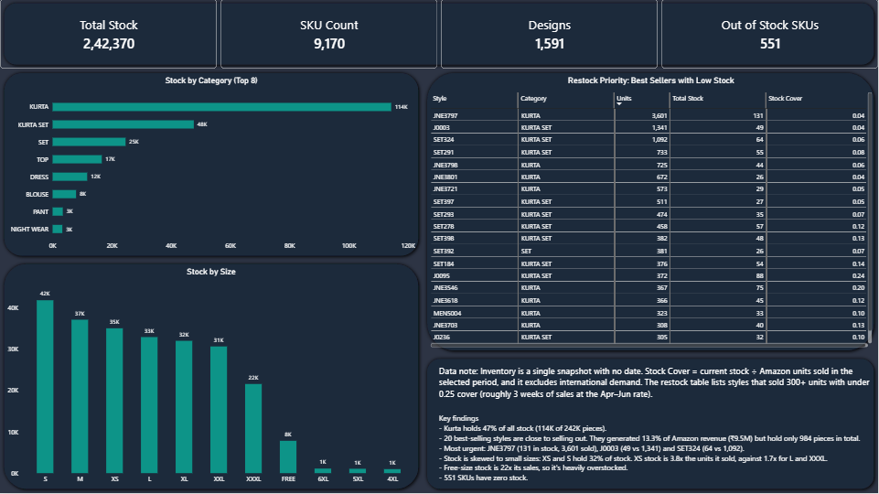

# E-commerce Sales, Fulfilment & Inventory Dashboard (Power BI)

An end-to-end Power BI project that turns three messy CSV exports from an Indian ethnic-wear seller into a six-page interactive dashboard covering **Amazon sales, order cancellations and returns, B2B export sales, and inventory risk**.

> **Author:** _Mohammad Shahzaib Raza_ · **Tools:** Power BI Desktop, Power Query (M), DAX · **Data period:** Jun 2021 – Jun 2022


---

## 1. Business problem

The seller sells through Amazon India (B2C) and to international boutiques (B2B), and keeps stock in a warehouse. Management needs to know:

1. How is revenue trending, and which products and states drive it?
2. Where are cancellations and returns highest, and what is behind them?
3. How does the international B2B channel compare with Amazon?
4. Which best-selling styles are about to run out of stock?

## 2. Data sources

| File | Content | Rows used | Period |
|---|---|---|---|
| `Amazon_Sale_Report.csv` | Amazon order lines (status, fulfilment, state, category, amount) | 128,968 | 31 Mar – 29 Jun 2022 |
| `International_sale_Report.csv` | B2B export sales by customer, style and size | 18,635 | 5 Jun 2021 – 11 May 2022 |
| `Sale_Report.csv` | **Inventory snapshot** (SKU, design, stock, size, colour). Despite its name, it holds stock, not sales | 9,188 | Undated snapshot |

Other files supplied with the dataset (pricing sheets, an expense ledger and a warehouse rate card) were reviewed and **deliberately left out**: their SKU format does not match the sales data, or they were too small to analyse.

## 3. Data cleaning (Power Query)

**Amazon sales**
- Removed index/blank columns; fixed a column name with a trailing space.
- Parsed `Date` from text using the US locale (MM-dd-yy) so that days and months are not swapped.
- Removed 7 duplicate order lines (`Order ID` + `SKU`) → 128,968 rows.
- Set null `Amount` to 0 (cancelled/pending orders); filled missing city/state/courier text with "Unknown".
- Grouped 13 raw `Status` values into 6: **Delivered, Shipped, Returned, Cancelled, Pending, Lost/Damaged**.
- Standardised `ship-state` (upper-case, trim, merged variants such as *Orissa → Odisha*, *New Delhi → Delhi*, *Rajsthan → Rajasthan*): 69 values → 37.

**International sales**
- The file had **18,797 junk rows** (stray SKU codes with every other field empty) below the real 18,635 data rows; these were removed.
- Parsed `DATE` with an explicit `Date.FromText(..., [Format="MM-dd-yy", Culture="en-US"])` and dropped the unreliable `Months` text column.
- Standardised customer names (trim, clean, upper-case, punctuation): 161 → 148 customers.

**Inventory**
- Removed rows with no `SKU Code`; set `Stock` to whole numbers.
- Noted ~20 rows with `#REF!` (a broken spreadsheet formula) as SKU code, all with zero stock.

## 4. Data model

A star schema with two shared dimensions and three fact tables:

```
Dim_Date ──┬── Amazon_Sales
           └── Intl_Sales
Dim_Product ─┬── Amazon_Sales   (Style)
             ├── Intl_Sales     (Style)
             └── Inventory      (Design No.)
```

- **`Dim_Date`**: calendar table (Jun 2021 – Jun 2022) with a sort column so months order chronologically; marked as the date table.
- **`Dim_Product`**: one row per style, built with DAX from the styles in all three tables, with category taken from the inventory file so that every table shares one category definition.
- All relationships are many-to-one, single direction. Fact tables never connect to each other directly (avoids many-to-many ambiguity).



## 5. Key DAX measures

```dax
Revenue = CALCULATE(SUM(Amazon_Sales[Amount]), Amazon_Sales[Status Group] <> "Cancelled")
Orders  = CALCULATE(DISTINCTCOUNT(Amazon_Sales[Order ID]), Amazon_Sales[Status Group] <> "Cancelled")
AOV     = DIVIDE([Revenue], [Orders])

Cancel % = DIVIDE(
    CALCULATE(COUNTROWS(Amazon_Sales), Amazon_Sales[Status Group] = "Cancelled"),
    COUNTROWS(Amazon_Sales))

Return % (Merchant) = DIVIDE(
    CALCULATE(COUNTROWS(Amazon_Sales), Amazon_Sales[Status Group] = "Returned"),
    CALCULATE(COUNTROWS(Amazon_Sales), Amazon_Sales[Fulfilment] = "Merchant"))

Return % (Merchant, min 200) = IF([Merchant Lines] >= 200, [Return % (Merchant)])

Intl Revenue = SUM(Intl_Sales[GROSS AMT])
Stock Cover  = DIVIDE([Total Stock], [Units])
```

Other measures: Units, Total Orders, Merchant Lines, Order Lines, Intl Units, Customers, Avg Rate per Piece, Top Customer Share, Total Stock, SKU Count, Designs, Out of Stock SKUs, Top State, Top 5 Share.

## 6. Dashboard pages

| Page | What it shows |
|---|---|
| **Overview** | KPI cards, monthly revenue, revenue by category, order status mix |
| **Products** | Top 10 styles with stock cover, units by size, AOV and return rate by category |
| **Geography** | Revenue by state (bar + filled map), top-state and Top-5 share |
| **Fulfilment & Returns** | Cancel % by month and fulfilment, status by fulfilment, Merchant return rates by category and state |
| **International B2B** | Revenue trend, top customers and styles, size mix |
| **Inventory** | Stock by category and size, restock-priority table |
| **Key Insights** | Summary of findings and recommended actions |








## 7. Key insights

| # | Insight | Evidence |
|---|---|---|
| 1 | **Amazon revenue is falling** | ₹26.2M (Apr) → ₹24.0M (May) → ₹21.4M (Jun): −8.7% and −10.7% month on month |
| 2 | **Two categories drive the business** | Kurta + Kurta Set = 65% of Amazon revenue |
| 3 | **Sales are concentrated by geography** | Top 5 states ≈ 56% of revenue; Maharashtra alone 17% |
| 4 | **Merchant-fulfilled orders cancel more** | 17.5% vs 12.8% for Amazon-fulfilled, in every month. All Merchant orders ship Standard, so shipping speed may play a part |
| 5 | **Kerala is a cancellation hotspot** | 17.8% cancel rate on 6,584 order lines, against 14.2% overall |
| 6 | **Returns are highest in eastern states** | Merchant orders: Assam 11.8%, Jharkhand 9.5%, Bihar 9.3%, Odisha 8.9% (overall Merchant rate 5.4%) |
| 7 | **Best sellers are close to selling out** | 20 styles with under 0.25 stock cover generated 13.3% of revenue (₹9.5M) but hold only 984 pieces |
| 8 | **Stock mix is skewed to small sizes** | XS + S hold 32% of stock; XS stock is 3.8× the units it sold vs 1.7× for L |
| 9 | **B2B is seasonal and concentrated** | ₹15.77M from 148 customers; peaks in Oct (₹2.9M) and Feb (₹2.4M); one customer = 13.3% of revenue, top 10 = 40% |

**Recommended actions:** restock the 20 low-cover styles first (JNE3797, J0003, SET324); investigate Kerala cancellations and test whether Standard shipping is a driver; rebalance purchasing toward M, L and XL; reduce dependence on the top B2B customers and plan for the Oct/Feb peaks.

## 8. Limitations

- Amazon data covers only 31 Mar – 29 Jun 2022 (March has a single day), so trends rest on three months.
- **Return data exists only for Merchant-fulfilled orders.** Amazon-fulfilled orders only ever show Shipped, Cancelled or Pending, so return rates are calculated on Merchant orders only.
- The inventory file is an undated snapshot. Stock Cover = stock ÷ Amazon units sold in the selected period, and ignores international demand.
- International amounts are assumed to be INR (the file has no currency column).
- The Amazon and international channels overlap only in Apr – mid May 2022, so they are not compared month by month.

## 9. Repository contents

```
├── Ecommerce_Dashboard.pbix
├── README.md
├── images/            
└── data/              
```

## 10. Skills demonstrated

Data cleaning and profiling in Power Query · star-schema modelling · DAX (CALCULATE, TOPN, DATEADD, variables) · KPI and visual design · handling data-quality issues and stating limitations honestly.
